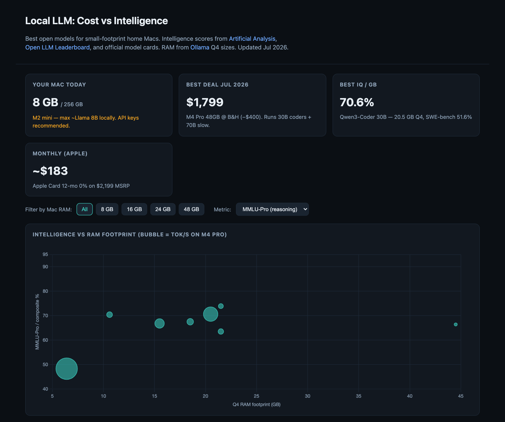
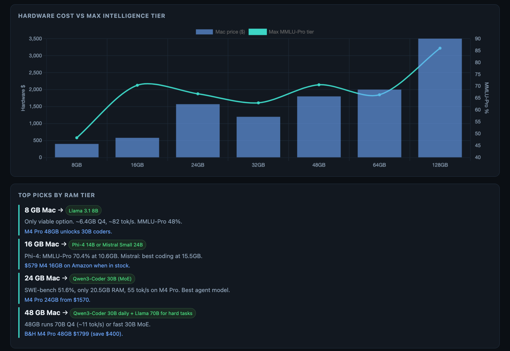

<div align="center">

<h1>Local LLM: Cost vs Intelligence</h1>

<p><b>Which open model fits which Mac, and what it costs.</b></p>

<p><i>RAM decides what a Mac can run locally. This page puts benchmark scores, Q4 memory footprints and Mac prices on one chart.</i></p>

<h6>


</h6>

<a href="#whats-on-the-page"><b>What's on the page</b></a> ·
<a href="#the-data"><b>The data</b></a> ·
<a href="#open-it"><b>Open it</b></a>

<br><br>



<sub>The page as it opens, all RAM tiers, MMLU-Pro metric. Hand-collected figures from July 2026.</sub>

</div>

<br>

A one-file guide to running open LLMs on a small home Mac. It compares eight models,
from Llama 3.1 8B up to Llama 3.1 70B, by how much memory they need at Q4 quantisation, how they
score on reasoning and coding benchmarks, how fast they run on an M4 Pro, and the cheapest Mac
with enough RAM for each. It is a snapshot: the numbers are typed into the page, not fetched.

## What's on the page

<div align="center">



<sub>Hardware cost against the best model each RAM tier can run, and the top picks per tier.</sub>

</div>

- **Intelligence vs RAM.** A bubble chart of benchmark score against Q4 footprint; bubble size is tokens per second on an M4 Pro. Hover a bubble for the model, RAM, score, minimum Mac and speed.
- **Filters.** Buttons narrow everything to models that fit an 8, 16, 24 or 48 GB Mac; a dropdown switches the score between MMLU-Pro, HumanEval coding and a composite index.
- **Hardware cost vs max intelligence.** Mac price per RAM tier (8 GB to 128 GB) as bars, with the best MMLU-Pro reachable at that tier as a line. Tooltips add the model and memory bandwidth.
- **Top picks by RAM tier.** One recommendation each for 8, 16, 24 and 48 GB, with the reason and an upgrade note.
- **Full comparison table.** Every model with Q4 RAM, minimum Mac, MMLU-Pro, coding score, tok/s, cheapest Mac price and links to its model card and Ollama page.

## The data

| Figure | Source |
|---|---|
| MMLU-Pro, coding benchmarks | Official model cards, [Open LLM Leaderboard](https://huggingface.co/docs/leaderboards/main/open_llm_leaderboard/about), [Artificial Analysis](https://artificialanalysis.ai/models/open-source/small) |
| Q4 RAM footprint | [Ollama library](https://ollama.com/library) download sizes |
| Tokens per second | [SiliconScore M4 Pro](https://siliconscore.com/chips/m4-pro/) and community benchmarks |
| Mac prices | [AppleInsider price guide](https://prices.appleinsider.com/mac-mini-m4) and retailer listings, July 2026 |

Coding scores come from different benchmarks: HumanEval for most models, SWE-bench for Qwen3-Coder 30B
and LiveCodeBench for DeepSeek-R1-Distill 32B. The table names the benchmark next to each score, and
the coding chart plots HumanEval only, listing the other two below it. "Best IQ / GB" is MMLU-Pro
divided by Q4 footprint. Mac prices are the cheapest model with that much RAM. Prices and deals are
from July 2026 and will have moved.

## Open it

No build step and no server. Chart.js loads from jsDelivr.

```bash
git clone https://github.com/parthchandak02/local-llm-intelligence.git
open local-llm-intelligence/index.html
```

To update the figures, edit the `HARDWARE`, `MODELS` and `PICKS` arrays in the `<script>` block at
the bottom of `index.html`.

<br>

<div align="center">
<sub>Built with Chart.js in a single HTML file. Not financial advice.</sub>
</div>
